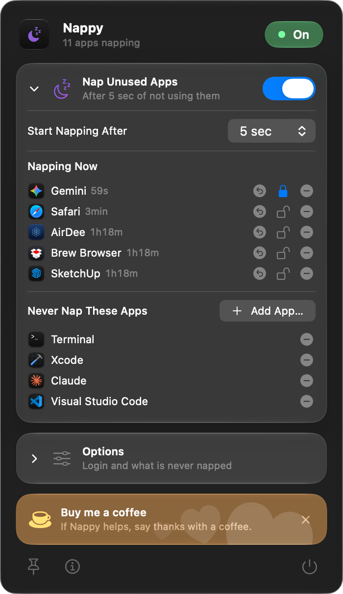

<p align="center">
  
</p>

<h1 align="center">Nappy</h1>

<p align="center">A small menu bar app for the Mac that puts apps you are not using to sleep, so your Mac works less and uses less power. 😴</p>

> ✅ **Version 1.0.** Built for a very recent macOS (the project targets macOS 27.2) and uses the new glass look.

<p align="center">
  
</p>

## 📥 Installing (a little extra work)

I do not have a paid Apple Developer account, so Nappy is **not signed or notarized by Apple**. macOS will block it the first time, and opening it takes a few extra steps:

1. Download the zip from [Releases](../../releases), unzip it, and move **Nappy.app** to your Applications folder.
2. Open it once. macOS says it cannot be verified. Close that message.
3. Open **System Settings → Privacy & Security**, scroll down, and click **Open Anyway** next to Nappy. Confirm with your password.
4. Or, in Terminal, remove the quarantine flag and open it normally:
   ```bash
   xattr -dr com.apple.quarantine /Applications/Nappy.app
   ```

You only need to do this once. If you would rather not run an unsigned app, that is fair: wait for a signed release.

## 🌙 What is Nappy?

Most Mac apps keep doing things in the background even when you are not looking at them: checking for updates, redrawing hidden windows, running timers. Nappy notices the apps you are not using and asks macOS to give them the lowest priority, so they use less of your processor, disk and network. When you come back to an app, it is back to normal right away. Nothing is closed, so you lose no work.

Nappy lives in the menu bar. There is no Dock icon and no main window.

## ⚙️ How it works

1. Nappy checks your running apps every few seconds.
2. An app that has stayed in the background for the time you choose (5 seconds to 1 hour) is put into **macOS background mode**: lowest CPU priority, slower disk and network, timers grouped together. The app keeps running, so sound, downloads and sync are not cut off.
3. The app's helper processes (for example the web content processes of a browser) are slowed down together with it.
4. The moment you switch back to the app, press its wake button, or quit Nappy, everything goes back to normal. If Nappy ever quits unexpectedly, it puts everything back the next time it opens.

Some apps are never napped: the app you are using, apps on your ignore list, macOS's own parts (Finder, Dock, and so on), and, if you keep the safety options on, apps that are playing sound, in a call or downloading.

## 🧰 What is in the menu

- 🌙 **Nap Unused Apps**: the main switch, and how long an app must be unused before it naps.
- 😴 **Napping Now**: the apps that are napping, newest first, with how long each has napped. Each row has buttons to wake the app, lock it (see below), or never nap it again.
- 🛡️ **Never Nap These Apps**: your ignore list. Add any open app, or choose one from your Applications folder.
- ⚙️ **Options**
  - *Open Nappy at Login*
  - *Don't Nap Apps You Can See*: apps with a window showing on screen, for example side by side, are left alone.
  - *Don't Nap Busy Apps*: apps playing sound, in a call or downloading keep running normally. The icons of the apps Nappy currently sees as busy are shown under this option.
- 📌 **Pin** (bottom left): turns the menu into a window that stays open.
- ℹ️ **About** and ☕ **Buy me a coffee**: next to the pin. The coffee button stays hidden while the orange coffee card at the bottom of the menu is showing. Close the card with its ✕ and the button appears in the footer. The card comes back after 3 days.

### 💪 Two stronger tools

- 🔒 **Lock** (the padlock on a napping app): while the app naps with no window showing, it is paused completely, so it cannot wake itself. This saves the most, but see "Good to know". Nappy wakes a locked app when you switch to it, point at one of its windows, point at the Dock, or open Activity Monitor, and before you log out or shut down.
- ⚡ **Electron app helpers**: for apps built with Electron (for example Figma or Notion), the parts that draw the screen are paused in short cycles while the app naps.

> [!WARNING]
> **Disclaimer:** locking an app can cause problems with its notifications. A locked app is paused, so it may show notifications late or not at all, and messages, calls and reminders can be missed until the app is woken. Do not lock apps you rely on for alerts (chat, mail, calendar, timers). You use Lock at your own risk.

## 🪶 Light on your Mac

Nappy is meant to cost almost nothing itself. Measured on the author's Mac:

- 🧠 **Memory:** about 12 MB right after launch, about 25 MB while the menu is open, and about 22 MB again once it is closed. The menu builds its content only while it is open.
- ⚡ **Processor:** about 0.2% of one core when idle.

The numbers vary a little between Macs and macOS versions.

## 💡 Good to know

- 🍃 **It is not the real App Nap.** macOS does not let one app switch another app into App Nap, so Nappy uses the closest thing it is allowed to use: background priority. Apps that are truly idle already use almost nothing, so the savings show mostly with apps that do a lot of work in the background.
- 📉 **Savings are modest and vary.** In the author's own tests, the processor work of background apps dropped by roughly a third to a half, and the number of times the processor was woken dropped by about half. Battery savings depend on what you do, and have not been proven by a proper test.
- ⏸️ **Locked apps are paused, not just slowed.** A paused app cannot show notifications, sync, or answer other apps until it is woken, so locking an app can make you miss its notifications. A "Quit" command sent to a paused app by another program does nothing until the app is woken (Force Quit always works). Opening a paused app through Spotlight or a notification has not been fully tested.
- 🐢 **Apps may feel slower for a moment** right after you switch back to them while they catch up.
- 🎮 **Games and video editors:** add them to the ignore list. Napping an app that is busy in the background can make it stutter.
- 📦 **Nappy is not sandboxed** because it needs to change other apps' priority. That means it cannot be sold in the Mac App Store, and the builds are not signed by Apple (see "Installing" above), so macOS asks you to confirm opening it.
- 💾 Your settings are saved on your Mac. The default ignore list includes Terminal, iTerm2, Xcode, Claude and VS Code if they are installed.

## 🔒 Privacy

🙈 Nappy does not collect anything and does not talk to the internet.

- 🚫 It has no analytics, no accounts and no network code. The only link is the *Buy me a coffee* card and button, which open a web page in your browser when you press them.
- 👀 It looks only at what it needs to decide whether to nap an app: which apps are running, which one is in front, where windows are on screen (position and size, not their contents), and which apps have asked macOS to keep the Mac awake. It does not read your files, your documents or the contents of any window, and it does not take screenshots.
- 🏠 Your settings (delay, ignore list, locked apps) stay on your Mac in the app's preferences. The public build writes no log files.

## ☕ Support

If Nappy is useful to you, you can [buy me a coffee ☕](https://buymeacoffee.com/nrohtved).
