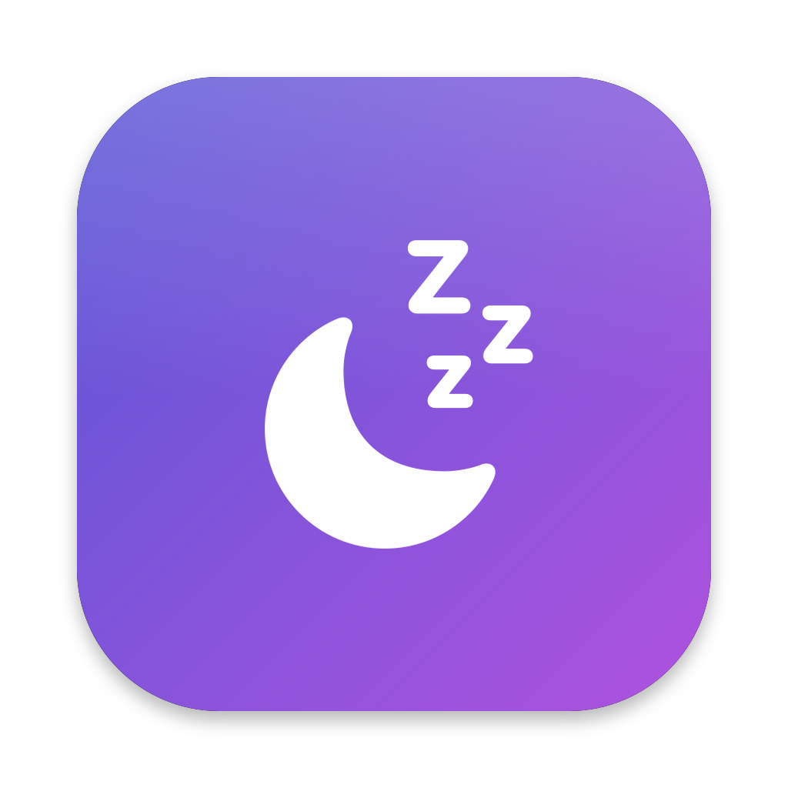

  

<h1 align="center">Nappy</h1>

A small menu bar app that puts apps you are not using to sleep, so your Mac works less and uses less power. 😴

> 🚧 **Early alpha (0.1.0).** Built for a very recent macOS (27.2) with the new glass look.

## 🌙 What it does

Apps keep working in the background even when you are not looking at them. Nappy finds the ones you are not using and asks macOS to give them the lowest priority. When you come back, they are back to normal right away. Nothing is closed, so you lose no work.

Nappy lives in the menu bar. No Dock icon, no main window.

## ⚙️ How it works

1. Nappy checks your apps every few seconds.
2. An app unused for the time you choose (5 seconds to 1 hour) goes into **macOS background mode**: lowest CPU priority, slower disk and network. Sound, downloads and sync keep working.
3. Switch back to the app (or quit Nappy) and everything returns to normal. After a crash, Nappy restores everything on the next launch.

Never napped: the app you are using, apps on your ignore list, macOS parts like Finder and Dock, and (with the safety options on) apps that play sound, are in a call or are downloading.

## 🧰 What is in the menu

- 🌙 **Nap Unused Apps**: the main switch and the delay.
- 😴 **Napping Now**: napping apps, newest first. Wake, lock, or never nap each one.
- 🛡️ **Never Nap These Apps**: your ignore list.
- ⚙️ **Options**: open at login, skip visible apps, skip busy apps.
- 📌 **Pin**: keep the menu open as a window.

**🔒 Lock** pauses a napping app completely for the biggest saving. Nappy wakes it when you switch to it, point at its window or the Dock, open Activity Monitor, or shut down.

## 💡 Good to know

- 🍃 It is not the real App Nap (macOS does not allow that). Nappy uses background priority, the closest thing allowed.
- 📉 Savings are modest. In the author's tests, background CPU work dropped by about a third to a half. Battery savings are not proven.
- ⏸️ A locked app cannot sync, notify or answer a "Quit" from another program until it wakes. Force Quit always works.
- 🎮 Games and video editors: add them to the ignore list.
- 📦 Not sandboxed and not yet signed, so macOS may ask you to confirm opening it (right-click → Open).

## 🔒 Privacy

Nappy collects nothing and has no network code. The only link is the *Buy me a coffee* card and button, which open a web page when you press them. It sees only which apps run, which is in front, and where windows are (not what is in them). Settings stay on your Mac.

## ☕ Support

If Nappy is useful, you can [buy me a coffee](https://buymeacoffee.com/nrohtved).
